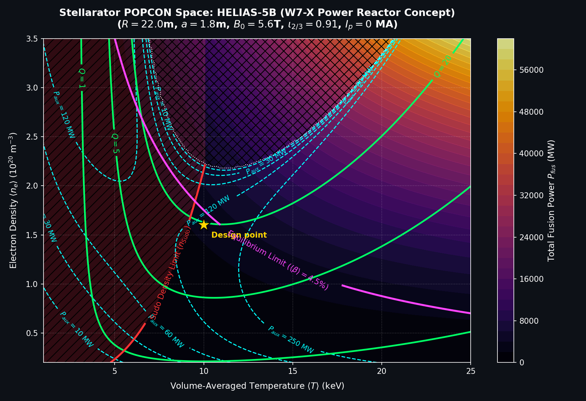

<div align="center">

# IotaTwin

**A stellarator digital twin, built from the ground up one physics layer at a time.**

<sub>Named for ι (iota), the rotational transform: the twist in the magnetic field that defines a stellarator.</sub>




<sub><i>Plasma operating contour (POPCON) map for a HELIAS-5B-class stellarator reactor, showing fusion power, gain contours, auxiliary heating, and the density and beta limits that bound where the machine can actually run.</i></sub>

</div>

---

## The short version

> **For friends, family, and anyone in a hurry.**
>
> Fusion is the process that powers the Sun: light atoms squeezed together until they fuse and release enormous amounts of energy. To do it on Earth you have to hold a gas hotter than the Sun's core (a *plasma*) inside a magnetic "bottle" so it never touches the walls.
>
> A **stellarator** is one design for that bottle. Instead of a simple donut, it uses intricately twisted magnets that hold the plasma in place on their own, with no need to drive a large electric current through it. That makes stellarators naturally steady and hard to disrupt, which is why many people (me included) think they are the future of fusion power. Germany's **Wendelstein 7-X** is the flagship experiment.
>
> A **digital twin** is a computer model of a machine detailed enough to mirror the real thing: predict how it behaves, test ideas safely, and eventually track a real device's data.
>
> This project is my attempt to build one for a stellarator, starting from the simplest possible model and adding real physics step by step, so that by the end I understand these machines inside and out.

---

## Table of contents

- [Why this project](#why-this-project)
- [What it does today](#what-it-does-today)
- [Reference design point](#reference-design-point)
- [Quick start](#quick-start)
- [Repository layout](#repository-layout)
- [Physics models](#physics-models)
- [Assumptions and limitations](#assumptions-and-limitations)
- [Roadmap](#roadmap)
- [About me](#about-me)
- [How this was built](#how-this-was-built)
- [References](#references)
- [License](#license)

---

## Why this project

Stellarators are one of the most promising and least taught paths to fusion energy. Even five semesters into a nuclear engineering degree, they have barely come up in my coursework. I want to change that for myself.

Seeing the digital twin work built around Purdue's PUR-1 research reactor showed me how powerful a faithful computational model of a real machine can be. This project applies that idea to the device I find most fascinating: build the physics up layer by layer, and design the code so it could eventually be pointed at a real machine like **Wendelstein 7-X**.

The goals, in order:

1. **Deep understanding.** Reach near-mastery of stellarator physics, operation, and design by implementing it myself.
2. **A reusable systems code.** A clean library of the calculations a stellarator twin needs, each one documented and checked against the literature.
3. **Twin-readiness.** Apply that library to W7-X to show it can be integrated with real device data.

---

## What it does today

The current model is a **0D (volume-averaged) steady-state power balance** for a stellarator reactor. Given a plasma density and temperature, it answers: *how much fusion power do we get, how much external heating does it take, and is that operating point physically allowed?*

Sweeping that over a grid of densities and temperatures produces the **POPCON** map above, a standard tool for locating a reactor's viable operating window.

| Capability | Model |
|---|---|
| D-T fusion reactivity | Bosch-Hale parameterization |
| Energy confinement time | ISS04 stellarator scaling, solved self-consistently with loss power |
| Radiation losses | Bremsstrahlung with Z<sub>eff</sub> |
| Density limit | Sudo limit (scales with heating power) |
| Pressure limit | Volume-averaged β equilibrium/ballooning limit (4.5%) |
| Performance metrics | Q, P<sub>aux</sub>, P<sub>α</sub>, τ<sub>E</sub>, ⟨β⟩, neutron wall loading |
| Visualization | Annotated POPCON plot with ignited region and design point |

---

## Reference design point

The default configuration models **HELIAS-5B**, a five-period reactor-scale concept derived from the Wendelstein 7-X optimization.

| Machine parameter | Value |
|---|---|
| Major radius R | 22.0 m |
| Effective minor radius a | 1.8 m |
| Field on axis B<sub>0</sub> | 5.6 T |
| Rotational transform ι<sub>2/3</sub> | 0.91 |
| Plasma current I<sub>p</sub> | 0 (no driven current) |
| Confinement factor H<sub>ISS04</sub> | 1.35 |

At the design point **⟨n<sub>e</sub>⟩ = 1.6×10²⁰ m⁻³, ⟨T⟩ = 10 keV**, chosen to sit inside both operating limits with margin:

| Output | Value |
|---|---|
| Fusion power P<sub>fus</sub> | **2.55 GW** |
| Fusion gain Q | **18.8** |
| Alpha heating P<sub>α</sub> | 510 MW |
| Required auxiliary heating P<sub>aux</sub> | 136 MW |
| Energy confinement time τ<sub>E</sub> | 1.91 s |
| Volume-averaged β | 4.11% (limit 4.5%) |
| Sudo density limit | 1.78×10²⁰ m⁻³ (operating at 90%) |
| Neutron wall loading | 1.30 MW/m² |

---

## Quick start

```bash
git clone https://github.com/<github-username>/IotaTwin.git
cd IotaTwin
pip install -r requirements.txt
python stellarator_0d.py
```

This prints the design point summary and opens the POPCON plot. To explore a different machine, edit the `ReactorConfig` dataclass at the top of `stellarator_0d.py`.

---

## Repository layout

```
IotaTwin/
├── stellarator_0d.py        # 0D stellarator power balance + POPCON (main model)
├── docs/
│   └── popcon_helias5b.png  # Figure shown above
├── testing_the_waters/
│   ├── tokamak_0d.py        # First experiment: SPARC-class tokamak 0D model
│   └── Stellarator_it1.png  # First stellarator POPCON iteration
├── requirements.txt
└── LICENSE
```

`testing_the_waters/` holds where this started: a 0D model of a compact high-field tokamak (SPARC-class) using IPB98(y,2) confinement, Greenwald and Troyon limits. Building it first made the differences that define a stellarator (no plasma current, a different confinement scaling, a different density limit) concrete.

---

## Physics models

<details>
<summary><b>Fusion power</b></summary>

For a 50:50 D-T mix, the reaction rate density is ¼ n<sub>DT</sub>² ⟨σv⟩, with ⟨σv⟩ from the Bosch-Hale fit (valid 0.2 to 100 keV). Each reaction releases 17.6 MeV, of which 3.5 MeV (the alpha particle) stays in the plasma as self-heating. Fuel dilution from impurities is estimated from Z<sub>eff</sub>.
</details>

<details>
<summary><b>Energy confinement (ISS04)</b></summary>

τ<sub>E</sub> = 0.134 · H · a<sup>2.28</sup> R<sup>0.64</sup> P<sup>−0.61</sup> n<sub>19</sub><sup>0.54</sup> B<sub>0</sub><sup>0.84</sup> ι<sub>2/3</sub><sup>0.41</sup>

Because the scaling depends on the loss power P = W<sub>th</sub>/τ<sub>E</sub>, which itself depends on τ<sub>E</sub>, the code eliminates P algebraically and solves for τ<sub>E</sub> in closed form.
</details>

<details>
<summary><b>Operating limits</b></summary>

- **Sudo density limit:** n<sub>c</sub> = 0.25 √(P B / (a² R)) in 10²⁰ m⁻³, the empirical limit above which stellarator plasmas undergo radiative collapse. Unlike the tokamak Greenwald limit, it rises with heating power.
- **Beta limit:** ⟨β⟩ ≤ 4.5%, representative of HELIAS equilibrium and ballooning stability studies.
- **Ignited region:** where alpha heating alone exceeds losses, a 0D steady state is not self-consistent, so that region is hatched on the plot rather than trusted.
</details>

---

## Assumptions and limitations

This is a 0D model, so every quantity is a volume average. In particular:

- T<sub>i</sub> = T<sub>e</sub> and n<sub>i</sub> ≈ n<sub>e</sub>; no radial profiles.
- Plasma volume and wall area use an equivalent circular torus, not the true 3D stellarator geometry.
- Confinement comes from an empirical scaling law, not a transport calculation.
- Radiation includes bremsstrahlung only (no line or synchrotron radiation).
- Fuel dilution assumes a single low-Z impurity.

Removing these simplifications is exactly what the next phases are for.

---

## Roadmap

- [x] **Phase 0:** 0D tokamak power balance (*testing the waters*)
- [x] **Phase 1:** 0D stellarator power balance and POPCON for HELIAS-5B
- [ ] **Phase 2:** 1D radial model
  - [ ] Density and temperature profiles n(ρ), T(ρ) with profile-integrated fusion power and β
  - [ ] Real flux-surface geometry (V′(ρ)) from a W7-X/HELIAS equilibrium
  - [ ] Steady-state heat transport solver with neoclassical and anomalous diffusivities
  - [ ] Separate electron and ion temperatures; ECRH heating deposition profiles
  - [ ] Line radiation and impurity profiles
- [ ] **Phase 3:** Benchmark against published Wendelstein 7-X results
- [ ] **Phase 4:** Twin layer: modular, data-driven interface that can ingest device measurements

---

## About me

I'm Derek Brewer, an undergraduate in nuclear engineering at **Purdue University** (West Lafayette) (7th semester overall, 5th in the nuclear program). Fusion is the corner of nuclear engineering I find most compelling, and stellarators in particular. This is an independent project I work on alongside my coursework, aimed at building the kind of specialized, hands-on knowledge that classes don't yet cover.

📫 [derekpbrewer@gmail.com](mailto:derekpbrewer@gmail.com)

---

## How this was built

I use AI assistants (Claude and Gemini) as advanced teachers and pair programmers on this project: to explain the physics past where I currently understand, point me to the relevant literature, and help write and review the more complex code. Every model here is cross-checked against the published references below, and understanding *why* each line exists is the point of the project. Using these tools well is part of how modern engineering gets done, and I'd rather be upfront about it.

---

## References

1. H.-S. Bosch and G. M. Hale, "Improved formulas for fusion cross-sections and thermal reactivities," *Nuclear Fusion* **32**, 611 (1992).
2. H. Yamada *et al.*, "Characterization of energy confinement in net-current free plasmas using the extended International Stellarator Database," *Nuclear Fusion* **45**, 1684 (2005). (ISS04)
3. S. Sudo *et al.*, "Scalings of energy confinement and density limit in stellarator/heliotron devices," *Nuclear Fusion* **30**, 11 (1990).
4. F. Schauer, K. Egorov, and V. Bykov, "HELIAS 5-B magnet system structure and maintenance concept," *Fusion Engineering and Design* **88**, 1619 (2013).
5. ITER Physics Basis Editors, "Chapter 2: Plasma confinement and transport," *Nuclear Fusion* **39**, 2175 (1999). (IPB98(y,2), tokamak model)

---

## License

Copyright © 2026 Derek Brewer. All rights reserved. See [LICENSE](LICENSE). You're welcome to read and evaluate the code, but please ask before reusing it.
